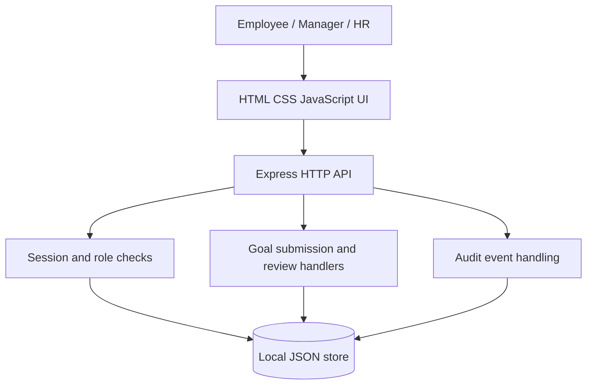
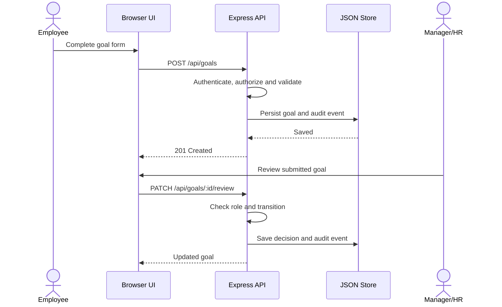
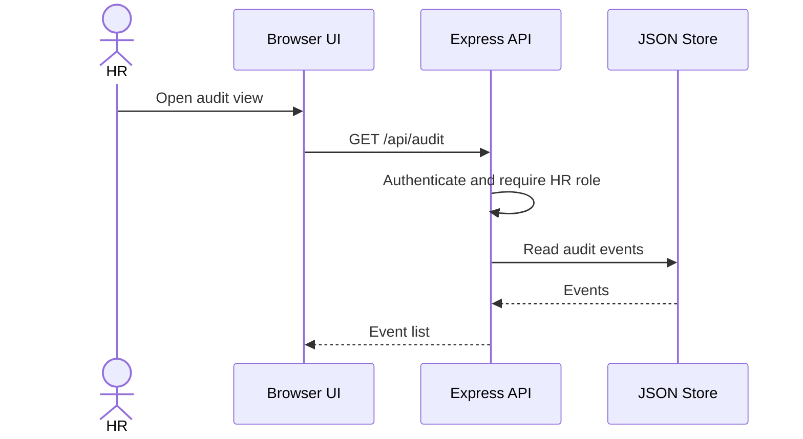

# Software Architecture and Design Specification (SAD)
**Project:** Automated Performance Appraisal System (APAS)  
**Version:** 1.1 | **Date:** 28 October 2026 | **Authors:** APAS project team  
**Status:** Draft for review; separates current implementation from proposed design.

## Revision history
| Version | Date | Author | Change summary |
|---|---|---|---|
| 1.0 | 28-Oct-2026 | Project team | Initial architecture draft |
| 1.1 | 28-Oct-2026 | Project team | Aligned stack, APIs and states with MVP; clarified future components |

## Approvals
| Role | Name | Approval/date |
|---|---|---|
| Team representative | To be assigned | Pending |
| Project guide/evaluator | To be assigned | Pending |

## 1. Introduction

### 1.1 Purpose
Describe the architecture and design of APAS, including the currently implemented goal workflow and the proposed full appraisal lifecycle.

### 1.2 Scope
Current MVP supports demo authentication, employee goal submission, manager/HR goal review and HR audit viewing. Cycle management, self-assessment, score/rank calculation, finalization, reporting and deployment are future increments.

### 1.3 Audience
Developers, testers, project guide, HR stakeholders and evaluators.

### 1.4 Definitions
API: application programming interface; RBAC: role-based access control; MVP: minimum viable prototype; ADR: architecture decision record.

## 2. Document overview

### 2.1 How to use this document
Read the current architecture and implemented API sections as descriptions of the repository. Sections explicitly marked proposed describe the future design, not existing functionality.

### 2.2 Related documents
- SRS: [SRS.md](SRS.md)
- Test Plan: [Test_Plan.md](Test_Plan.md)
- Decision register: [../../DECISIONS.md](../../DECISIONS.md)

## 3. Architecture

### 3.1 Goals and constraints
Goals are understandable separation of concerns, server-enforced authorization, traceability and testability. The current prototype is designed for local classroom demonstration only. It does not claim production availability or compliance.

### 3.2 Stakeholders and concerns
- Employees: privacy and understandable goal status.
- Managers: correct review permissions and feedback.
- HR: audit visibility and consistent policy.
- Developers: maintainable code and tests.
- Evaluators: consistency across SRS, design, tests and CI.

### 3.3 Component (UML) diagram
Current implementation is a small layered monolith:

Proposed future components include cycle configuration, progress tracking, assessment, scoring/ranking and reporting services. These are not yet present as independent modules.

### 3.4 Component descriptions
- **Browser UI:** `public/index.html`, `public/styles.css`, `public/app.js`; renders login and role-based goal/audit screens.
- **HTTP API:** `server.js`; Express routes and JSON request validation.
- **Authentication:** demo accounts use scrypt password hashes; server issues an HttpOnly, SameSite session cookie and checks roles for protected routes.
- **Goal workflow:** stores a goal and permits manager/HR review actions.
- **Audit:** records login/logout, goal submission and review events in the JSON store.
- **Persistence:** `data/store.json` is generated locally and ignored by Git. In-memory sessions and JSON persistence are not suitable for multi-instance/production use.
- **Future services:** appraisal cycle, progress, assessment, scoring/ranking and reporting remain planned.

### 3.5 Chosen architecture pattern and rationale
A **layered monolithic web application** is appropriate for this classroom MVP: one server process serves static UI and API endpoints, with simple local persistence. Microservices would add unnecessary deployment complexity for the current scope.

### 3.6 Technology stack and data stores
| Layer | Actual current choice | Status/limitation |
|---|---|---|
| UI | HTML, CSS, browser JavaScript | Implemented |
| Server/API | Node.js and Express | Implemented |
| Local storage | JSON file | Implemented for demo only; no database |
| Authentication | scrypt hashes, in-memory sessions, HttpOnly/SameSite cookie | Demo implementation; sessions reset on restart |
| Automated tests | Node built-in test runner and Fetch | Implemented subset |
| CI | GitHub Actions, Node.js 22, `npm run check` | Workflow configured; check latest Actions for result |
| Production database/deployment | Not selected | Future decision |

### 3.7 Risks and mitigations
| Risk | Mitigation |
|---|---|
| JSON file corruption or concurrent writes | Replace with transactional database before multi-user/production use |
| Session loss on restart | Adopt secure persistent session store for deployment |
| Unauthorized manager review | Implement manager-to-employee assignment and negative tests |
| Unapproved scoring policy | Obtain written guide/team approval before coding scoring |
| Overstated completion | Keep implementation status in SRS and test evidence explicit |

### 3.8 Traceability to requirements
- Authentication: FR-001, SR-002, SR-003.
- Goal workflow: FR-003, FR-004.
- Audit events: FR-014, SR-005.
- Cycle, progress, assessment, scoring, ranking and release: FR-002, FR-005, FR-007–FR-013, FR-015 are future components.

### 3.9 Security architecture
Threat considerations: spoofing (credential checks and session cookies), tampering (server-side validation and controlled review transitions), information disclosure (role checks and future record-level scoping), repudiation (audit events), denial of service (request size limit and login throttling), and elevation of privilege (deny-by-default role middleware). Current demo has no production TLS configuration or persistent session store and must not be used for real employee data.

## 4. Design

### 4.1 Design overview and state model
Current goal statuses are **Submitted**, **Approved**, and **Needs revision**. The current review endpoint allows a goal to be reviewed when Submitted or Needs revision. It does not implement Draft, Rejected, appraisal-cycle states or final results. Proposed future appraisal states: Open → Self-assessment Submitted → Manager Review → HR Finalization → Released.

### 4.2 Sequence diagram 1 — submit and review a goal

### 4.3 Sequence diagram 2 — HR audit review (implemented)

Score calculation/finalization is not implemented; a sequence diagram for it should be added when that workflow is built.

### 4.4 API design
**Implemented endpoint A — submit a goal**
- Method/path: `POST /api/goals`
- Auth: employee role required.
- Request: `title`, `description`, `metric`, `dueDate`.
- Success: `201 Created` with goal data.
- Errors: `400` validation error, `401` unauthenticated, `403` wrong role.

**Implemented endpoint B — review a goal**
- Method/path: `PATCH /api/goals/:id/review`
- Auth: manager or HR role required.
- Request: `status` (Approved or Needs revision), `comment`.
- Success: `200 OK` with updated goal.
- Errors: `400` invalid decision, `401` unauthenticated, `403` wrong role, `404` unknown goal, `409` invalid current state.
- Limitation: assigned-manager-to-employee relationship is not yet enforced; this must be fixed before claiming record-level authorization.

Other current routes: `GET /api/health`, `POST /api/login`, `POST /api/logout`, `GET /api/me`, `GET /api/goals`, `GET /api/audit` (HR only).

**Proposed endpoint, not implemented:** `POST /api/appraisal-cycles/:cycleId/finalize`. It must require HR authorization, complete ratings, a versioned approved scoring policy, transaction-safe writes and audit logging before it is added.

### 4.5 Error handling, logging and monitoring
API returns safe JSON error messages. Request body size is limited; credentials are hashed; security response headers are set. Audit events are stored separately within the same JSON file. Production monitoring, central logs, database transactions and deployment TLS remain future work.

### 4.6 UX design
Current interface offers role-based workspace, status pills, goal forms, review feedback and HR audit list. Accessibility review and formal usability testing remain outstanding.

### 4.7 Open issues and next steps
1. Enforce assigned-manager/employee relationship before using real records.
2. Confirm scoring policy and tie handling with guide/team.
3. Replace JSON file and in-memory sessions before multi-user deployment.
4. Implement appraisal cycles, progress, self-assessment, manager ratings, scoring, finalization and reports.
5. Render/verify UML diagrams and add API contract tests.
6. Keep CI results and the test execution report linked to the exact commit.

## 5. Appendices
**Glossary:** KPI, RBAC, API, audit event, appraisal cycle.  
**References/tools:** project SRS and Test Plan; Mermaid for diagram source. Any additional standards/tools should be listed only when actually used.
