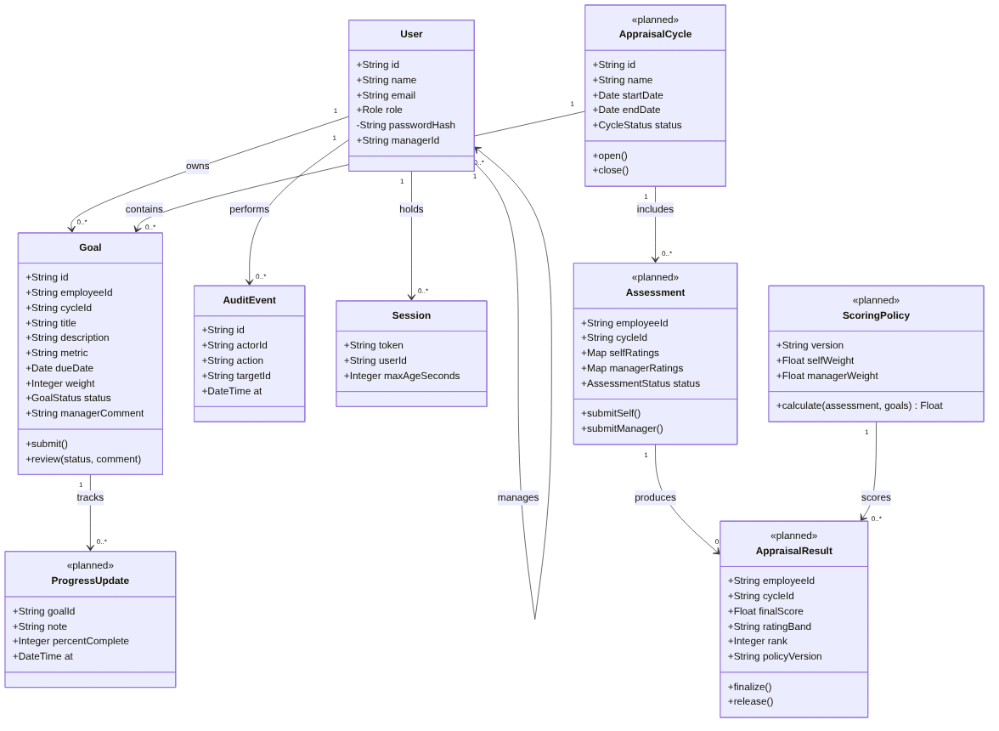
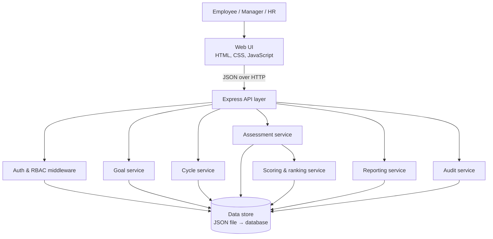
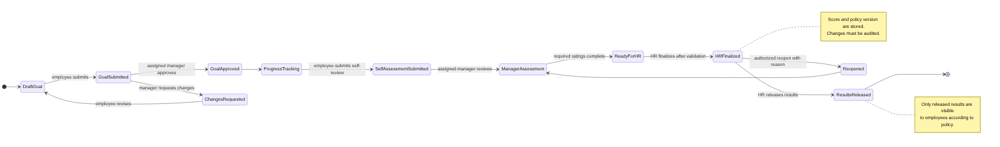
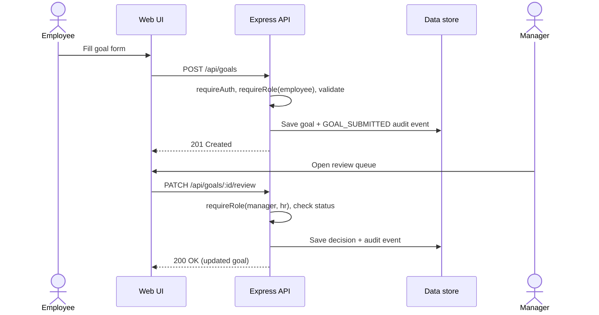
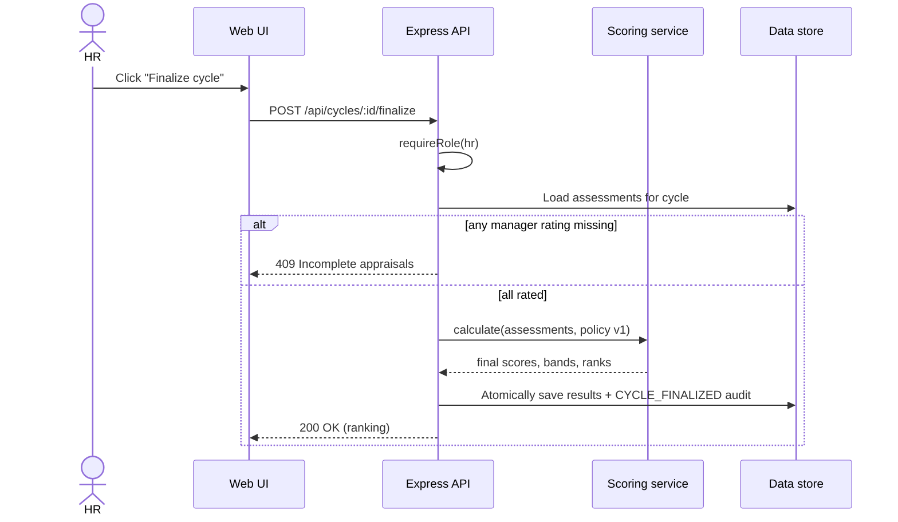

# Software Architecture and Design Specification (SAD)

**Project:** Automated Performance Appraisal System (APAS)
**Version:** 1.2
**Authors:** G Sai Hemanth (PES1UG24AM101), Nivas Reddy D (PES1UG24AM075), D A V Sreeram (PES1UG24AM076), J Karthik (PES1UG25AM804)
**Date:** 29-10-2026
**Status:** Draft for guide review

## Revision History

| Version | Date | Author | Change Summary |
|---|---|---|---|
| 1.0 | 27-10-2026 | Team 9 | Initial architecture draft |
| 1.1 | 28-10-2026 | Team 9 | Aligned stack, APIs and states with the MVP |
| 1.2 | 29-10-2026 | G Sai Hemanth | UML class diagram, component list matched to RTM, cleanup |

## Approvals

| Role | Name | Signature/Date |
|---|---|---|
| Course Coordinator | | |
| Team Lead | G Sai Hemanth | |

## 1. Introduction

### 1.1 Purpose
This document specifies the architecture and design of the Automated Performance Appraisal System (APAS).

### 1.2 Scope
Covers the full appraisal workflow: authentication, appraisal cycles, goal setting and review, progress tracking, self-assessment, manager rating, scoring, ranking, HR finalization, reporting and audit. Components already implemented in the Sprint 1 MVP and those scheduled for Sprint 2 are identified in sections 3.4 and 3.6.

### 1.3 Audience
Developers, testers, the course coordinator, evaluators and maintainers.

### 1.4 Definitions
API, RBAC, MVP, ADR (Architecture Decision Record), STRIDE, TLS, KPI.

## 2. Document Overview

### 2.1 How to use this document
Section 3 describes the architecture (components, pattern, stack, risks, security). Section 4 describes the detailed design (state model, sequence diagrams, APIs, error handling, UX).

### 2.2 Related Documents
[SRS](SRS.md), [Test Plan](Test_Plan.md), [RTM (CSV)](diagrams/requirements-traceability.csv), [Sprint schedule & Jira backlog](../README.md#sprint-schedule-and-jira).

## 3. Architecture

### 3.1 Goals & Constraints
**Goals:** clear separation of concerns, server-enforced authorization, reproducible scoring, testability and traceability to requirements.
**Constraints:** four-member team, two one-week sprints, Node.js runtime, synthetic data only, free tooling (GitHub, GitHub Actions).

### 3.2 Stakeholders & Concerns
- Employees: privacy and clear goal/result status
- Managers: correct review permissions, quick rating workflow
- HR: consistent policy, audit visibility, reliable rankings
- Developers: modular, testable code
- Evaluators: consistency between SRS, design, tests and CI

### 3.3 Component (UML) Diagram

**UML class diagram** (classes marked «planned» are delivered in Sprint 2):

**Component view** (layered monolith):

Sources: `diagrams/class-diagram.mmd`, `diagrams/component-architecture.puml`.

### 3.4 Component Descriptions

| Component | Responsibility | Implementation | Status |
|---|---|---|---|
| Web UI | Sign-in, role workspaces, goal form, review queue, audit view | `public/index.html`, `public/app.js`, `public/styles.css` | Implemented |
| Auth | Login/logout, scrypt password hashing, HttpOnly session cookie, `requireAuth` / `requireRole` middleware, login throttling | `server.js` | Implemented (record-level check in Sprint 2) |
| Goal | Submit goal, list goals by role, approve/return with comment, progress updates | `server.js` | Submit/review implemented; progress in Sprint 2 |
| Cycle | Create/open/close appraisal cycles | – | Sprint 2 |
| Assessment | Employee self-assessment and manager ratings per goal | – | Sprint 2 |
| Scoring | Apply versioned scoring policy, compute rating band and rank | – | Sprint 2 |
| Reporting | Cycle summary, ranking report, appraisal history | – | Sprint 2 |
| Audit | Append-only record of actor, action, target, timestamp; HR read access | `server.js` | Implemented |
| Data store | Users, goals, audit (and later cycles, assessments, results) | `data/store.json` with atomic temp-file rename | Implemented for demo |

### 3.5 Chosen Architecture Pattern and Rationale
A **layered monolith** (presentation → API → services → data store) running as one Node.js process. It keeps deployment and testing simple for a four-person, two-sprint project while still separating concerns. Microservices were rejected as unnecessary overhead at this scale; a pure client-side app was rejected because authorization must be enforced on the server.

### 3.6 Technology Stack & Data Stores

| Layer | Choice | Notes |
|---|---|---|
| UI | HTML, CSS, vanilla JavaScript | Served as static files by Express |
| Server/API | Node.js 20+, Express 4 | JSON REST API |
| Data store | JSON file (`data/store.json`) | Demo only; database planned (future work) |
| Security | Node `crypto` scrypt, HttpOnly SameSite cookie, CSP and security headers | Secure cookie flag in production |
| Testing | Node built-in test runner + fetch | `npm run check` |
| CI | GitHub Actions (Node 22) | Runs on every push and PR |

### 3.7 Risks & Mitigations

| Risk | Mitigation |
|---|---|
| JSON file corruption from concurrent writes | Atomic temp-file rename now; move to a transactional database before multi-user use |
| Sessions lost on server restart | Acceptable for demo; persistent session store before deployment |
| Manager reviews an employee they don't manage | Add `managerId` to users and record-level check (Jira APAS-15) |
| Scoring policy disputed | Versioned policy stored with each result; team approval (Jira APAS-12) |
| Docs drift from code | Update SRS/SAD/Test Plan in the same PR as code changes |

### 3.8 Traceability to Requirements

| Requirement | Component |
|---|---|
| FR-001, SR-002, SR-003, NFR-003 | Auth |
| FR-002, FR-006 | Cycle, Web UI |
| FR-003, FR-004, FR-005 | Goal |
| FR-007, FR-008 | Assessment |
| FR-009, FR-010, NFR-004 | Scoring |
| FR-011, FR-015, NFR-002 | Finalization (Scoring + Audit) |
| FR-012, FR-013 | Reporting |
| FR-014, SR-005 | Audit |
| SR-004, NFR-005 | API handlers, Web UI |

### 3.9 Security Architecture
**Threat modeling (STRIDE):**
- **Spoofing:** scrypt-hashed passwords, random 256-bit session tokens, login throttling after 8 failures.
- **Tampering:** server-side validation and controlled status transitions (409 on invalid state).
- **Repudiation:** audit events for login, logout, goal submission and review.
- **Information disclosure:** role checks on every route; employees see only their own goals; record-level manager scoping in Sprint 2.
- **Denial of service:** 32 KB request body limit and login rate limiting.
- **Elevation of privilege:** deny-by-default `requireRole` middleware; no client-side-only checks.

HTTP security headers: Content-Security-Policy, X-Frame-Options DENY, X-Content-Type-Options nosniff, Referrer-Policy same-origin. TLS is required for any deployment (SR-001).

## 4. Design

### 4.1 Design Overview
Goal statuses: **Submitted → Approved** or **Submitted → Needs revision → (resubmit) → Approved**. Appraisal states (Sprint 2): Open → Self-assessment submitted → Manager rated → HR finalized → Released, with an authorized Reopen back to manager review.

### 4.2 UML Sequence Diagrams

**Sequence 1 – Submit and review a goal (implemented)**

**Sequence 2 – HR finalizes a cycle and ranks employees (Sprint 2)**

### 4.3 API Design

**Component A – Goal service (implemented)**

| | Submit goal | Review goal |
|---|---|---|
| Endpoint | `/api/goals` | `/api/goals/:id/review` |
| Method | POST | PATCH |
| Auth | Employee | Manager or HR |
| Request | `{title, description, metric, dueDate}` | `{status: "Approved" \| "Needs revision", comment}` |
| Response | `201 {goal}` | `200 {goal}` |
| Errors | 400 validation, 401 not signed in, 403 wrong role | 400 invalid decision, 401, 403, 404 unknown goal, 409 invalid state |

**Component B – Auth (implemented)**

| | Sign in | Current user |
|---|---|---|
| Endpoint | `/api/login` | `/api/me` |
| Method | POST | GET |
| Request | `{email, password}` | session cookie |
| Response | `200 {user}` + `Set-Cookie: apas_session` | `200 {user}` |
| Errors | 401 invalid credentials, 429 too many attempts | 401 not signed in |

**Component C – Scoring/finalization (Sprint 2)**

| | Finalize cycle | Ranking |
|---|---|---|
| Endpoint | `/api/cycles/:id/finalize` | `/api/cycles/:id/ranking` |
| Method | POST | GET |
| Auth | HR | HR |
| Response | `200 {results: [{employeeId, finalScore, band, rank}]}` | `200 {ranking}` |
| Errors | 401, 403, 404 unknown cycle, 409 incomplete ratings or already finalized | 401, 403, 404 |

Other routes: `GET /api/health`, `POST /api/logout`, `GET /api/goals`, `GET /api/audit` (HR).

### 4.4 Error Handling, Logging & Monitoring
All errors return JSON `{error: "<user-friendly message>"}` with the correct HTTP status; stack traces are never sent to clients. Passwords and session tokens are never written to the audit log. Monitoring for the demo is the `/api/health` endpoint and GitHub Actions results; production would add centralized logs and uptime alerts.

### 4.5 UX Design
Single-page layout with a sign-in card, role badge, and role-specific panels: employee goal form with inline validation and status pills; manager review queue with Approve / Return buttons and a comment box; HR audit list. Responsive down to 360 px; status shown by text as well as colour.

### 4.6 Open Issues & Next Steps
1. Approve scoring policy v1 (Jira APAS-12).
2. Add manager–employee assignment and record-level checks (Jira APAS-15).
3. Implement cycles, progress, assessment, scoring, ranking and reports (Jira APAS-9 to APAS-14).
4. Add a deploy stage to the CI/CD pipeline (Jira APAS-18).
5. Replace the JSON store with a database (future work).

## 5. Appendices

### 5.1 Glossary
APAS, API, RBAC, KPI, STRIDE, TLS, ADR, MVP.

### 5.2 References
IEEE 42010 (architecture description), OWASP Top 10, project SRS and Test Plan.

### 5.3 Tools
Mermaid and PlantUML (diagrams), GitHub and GitHub Actions (version control and CI), VS Code, Node.js test runner.
