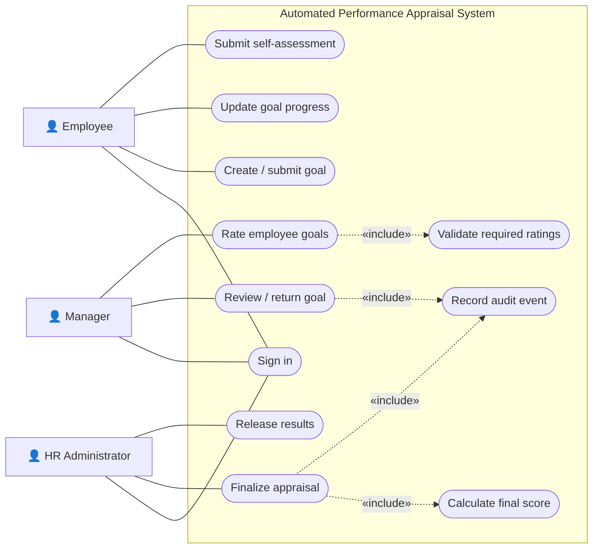
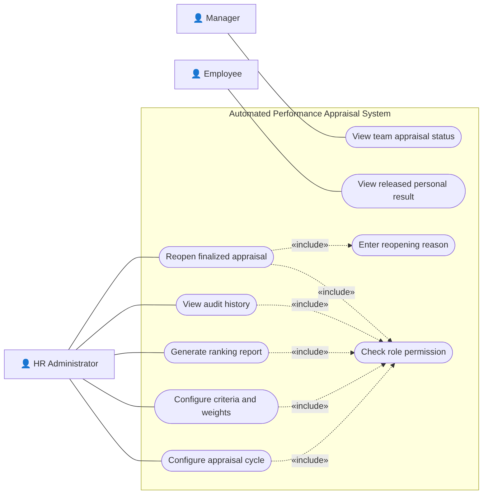

# Software Requirements Specification (SRS)

**Project:** Automated Performance Appraisal System (APAS)
**Version:** 1.2
**Authors:** G Sai Hemanth (PES1UG24AM101), Nivas Reddy D (PES1UG24AM075), D A V Sreeram (PES1UG24AM076), J Karthik (PES1UG25AM804)
**Date:** 29-10-2026
**Status:** Draft for guide review

## Revision history

| Version | Date | Author | Change summary | Approval |
|---|---|---|---|---|
| 1.0 | 27-10-2026 | Team 9 | Initial requirements | Pending |
| 1.1 | 28-10-2026 | Team 9 | Aligned with course template; implementation status added | Pending |
| 1.2 | 29-10-2026 | G Sai Hemanth | Feature-wise requirement tables, proposed scoring policy, use-case diagrams embedded, RTM in template format | Pending |

## Approvals

| Role | Name | Signature / Email | Date |
|---|---|---|---|
| Course Coordinator | | | |
| Team Lead | G Sai Hemanth | | |

## Table of Contents

1. Introduction
2. Overall description
3. External interfaces
4. System features (detailed)
5. Non-functional requirements (detailed)
6. Quality attributes & Acceptance tests
7. UML Use-Case Diagram
8. Requirements Traceability Matrix (RTM)

## 1. Introduction

### 1.1 Purpose
This document is the Software Requirements Specification for the Automated Performance Appraisal System (APAS). It defines the functional and non-functional requirements, interfaces and verification criteria for a typical company appraisal process, from setting goals at the start of a cycle to the year-end appraisal that produces employee rankings.

### 1.2 Scope
APAS covers appraisal-cycle setup, goal creation and approval, progress tracking, employee self-assessment, manager rating, score calculation, HR finalization, ranking, result release, reporting and audit logging. Payroll, recruitment, compensation decisions and integration with external HR systems are out of scope.

### 1.3 Audience
Developers, testers, the project guide/course coordinator, evaluators, and HR stakeholders.

### 1.4 Definitions
APAS – Automated Performance Appraisal System; KPI – Key Performance Indicator; Appraisal cycle – a defined review period (e.g. FY 2026); RBAC – Role-Based Access Control; RTM – Requirements Traceability Matrix; MVP – Minimum Viable Product; API – Application Programming Interface; TLS – Transport Layer Security.

## 2. Overall description

### 2.1 Product perspective
APAS is a standalone web application. Users work in a browser; a Node.js/Express server exposes a JSON API, enforces authentication and authorization, and persists data. The current release stores data in a local JSON file and keeps sessions in server memory; a database is planned before multi-user deployment.

### 2.2 Major product functions
- Authenticate users and enforce role-based access
- Configure appraisal cycles (HR)
- Create, submit, approve and return goals
- Record goal progress updates
- Submit employee self-assessment
- Rate employees against approved goals (manager)
- Calculate final scores using a versioned scoring policy
- Finalize appraisals and rank employees within a cycle (HR)
- Release results, view history and generate cycle reports
- Record audit events for all sensitive actions

### 2.3 User roles and characteristics
- **Employee:** sets goals, updates progress, submits self-assessment, views own released result. Basic computer literacy.
- **Manager:** reviews team goals, rates team members, adds feedback. Needs a quick overview of pending actions.
- **HR Administrator:** configures cycles and policy, finalizes and releases results, views reports and audit history.

### 2.4 Operating environment
Server: Node.js 20 or newer with npm on Windows, macOS or Linux. Client: current Chrome, Edge, Firefox or Safari on desktop or mobile. CI: GitHub Actions (Ubuntu, Node.js 22).

### 2.5 Constraints
- Only synthetic demo data may be used; no real employee records.
- Authorization must be enforced on the server, not only in the UI.
- Scores must be calculated by a documented formula; no AI-based scoring.
- The scoring policy (section 4.5.1) must be approved by the team before ranking is released.
- Course timeline: Sprint 1 27–31 Oct 2026, Sprint 2 2–7 Nov 2026.

## 3. External interface requirements

### 3.1 User interfaces
Responsive browser UI with a sign-in screen and a role-specific workspace: goal form and status pills for employees, review queue for managers, audit, cycle and ranking views for HR. Forms show inline validation messages; colour is not the only status indicator.

### 3.2 Hardware interfaces
No special hardware is required; any device that runs a modern browser is supported.

### 3.3 Software interfaces
- **APAS REST API (JSON over HTTP):** `/api/health`, `/api/login`, `/api/logout`, `/api/me`, `/api/goals`, `/api/goals/:id/review`, `/api/audit` (implemented); `/api/cycles`, `/api/goals/:id/progress`, `/api/assessments`, `/api/cycles/:id/finalize`, `/api/cycles/:id/ranking`, `/api/cycles/:id/report` (planned).
- **Persistence:** local JSON store (current), relational database (planned).
- **GitHub Actions:** automated build and test on every push and pull request.

### 3.4 Communications
- HTTP on localhost for development; HTTPS (TLS 1.2+) mandatory for any deployed instance.
- Session token in an HttpOnly, SameSite cookie; marked Secure in production.

## 4. System features (detailed)

Each requirement includes acceptance criteria and a reference test case defined in the Test Plan. IDs follow FR-### (functional), NFR-### (non-functional) and SR-### (security).

### 4.1 Authentication and access control
Description: Users sign in with email and password; the server issues a session and restricts every protected operation by role.

| Req ID | Requirement | Type | Priority | Source/Stakeholder | Acceptance criteria / Test case ref | Comments / Dependencies |
|---|---|---|---|---|---|---|
| FR-001 | The system shall authenticate users by email and password and enforce role-appropriate access on every protected operation. | Functional | High | Security / HR | Valid credentials create a session; wrong password is rejected; anonymous requests return 401. Test: TC-AUTH-01, TC-AUTH-02, TC-AUTH-03 | User store, session management |

### 4.2 Appraisal cycle management
Description: HR defines the appraisal period that groups goals, assessments and results.

| Req ID | Requirement | Type | Priority | Source/Stakeholder | Acceptance criteria / Test case ref | Comments / Dependencies |
|---|---|---|---|---|---|---|
| FR-002 | The system shall allow HR to create an appraisal cycle with a name, start date, end date and status (Open/Closed). | Functional | High | HR | Valid cycle stored; end date before start date and non-HR attempts rejected. Test: TC-CYCLE-01, TC-CYCLE-02 | Cycle model |
| FR-006 | The system shall show each user a dashboard of pending tasks and statuses for the current cycle, limited to records they are permitted to see. | Functional | Medium | All users | Counts and items match the records permitted to the signed-in user. Test: TC-DASH-01 | FR-002, record scoping |

### 4.3 Goal setting and review
Description: Employees propose measurable goals; the assigned manager approves them or returns them for revision; employees then record progress.

| Req ID | Requirement | Type | Priority | Source/Stakeholder | Acceptance criteria / Test case ref | Comments / Dependencies |
|---|---|---|---|---|---|---|
| FR-003 | The system shall allow an employee to submit a goal with title, description, success metric, due date and weight. | Functional | High | Employee | Valid goal saved with status Submitted; missing or invalid fields rejected with a clear message. Test: TC-GOAL-01, TC-GOAL-02 | Goal API |
| FR-004 | The system shall allow only the employee's assigned manager (or HR) to approve a goal or return it for revision with a comment. | Functional | High | Manager / HR | Decision and comment saved; unassigned manager is denied with no state change. Test: TC-GOAL-03, TC-GOAL-04 | Manager–employee assignment |
| FR-005 | The system shall allow an employee to record timestamped progress updates against an approved goal. | Functional | High | Employee | Update stored with timestamp and visible to the assigned manager. Test: TC-GOAL-05 | FR-004 |

### 4.4 Self-assessment and manager rating
Description: At year end the employee rates their own performance and the manager rates each approved goal.

| Req ID | Requirement | Type | Priority | Source/Stakeholder | Acceptance criteria / Test case ref | Comments / Dependencies |
|---|---|---|---|---|---|---|
| FR-007 | The system shall allow an employee to submit a self-assessment (rating 1–5 and comment per goal) while the cycle is open, and lock it after submission. | Functional | High | Employee | Submission timestamped; edits rejected after submit unless reopened by HR. Test: TC-APP-01, TC-APP-02 | FR-002 |
| FR-008 | The system shall allow the assigned manager to rate each approved goal of a team member on a 1–5 scale with comments. | Functional | High | Manager | All approved goals must be rated; out-of-range ratings and unassigned managers rejected. Test: TC-APP-03 | FR-004, FR-007 |

### 4.5 Scoring and ranking
Description: The system converts ratings into a final score and ranks employees within a cycle.

| Req ID | Requirement | Type | Priority | Source/Stakeholder | Acceptance criteria / Test case ref | Comments / Dependencies |
|---|---|---|---|---|---|---|
| FR-009 | The system shall calculate each employee's final score using the approved, versioned scoring policy (4.5.1). | Functional | High | HR | Known fixture returns the expected score (example below = 4.02); missing ratings block calculation. Test: TC-SCORE-01, TC-SCORE-02 | Scoring policy |
| FR-010 | The system shall rank finalized employees within the same cycle by final score, applying the documented tie rule. | Functional | High | HR | Correct order; ties handled per policy; non-finalized appraisals excluded. Test: TC-SCORE-03, TC-SCORE-04, TC-SCORE-05 | FR-009, FR-011 |

#### 4.5.1 Proposed scoring policy (v1, pending team approval – APAS-02)

1. **Rating scale:** 1 = Unsatisfactory, 2 = Needs improvement, 3 = Meets expectations, 4 = Exceeds expectations, 5 = Outstanding.
2. **Goal weights:** each employee's approved goals carry integer weights that sum to 100.
3. **Goal score** = 0.3 × self rating + 0.7 × manager rating.
4. **Final score** = Σ (goal weight × goal score) / 100, rounded to two decimals.
5. **Rating band:** ≥ 4.50 Outstanding; 3.50–4.49 Exceeds; 2.50–3.49 Meets; 1.50–2.49 Needs improvement; < 1.50 Unsatisfactory.
6. **Missing ratings:** an appraisal with any missing manager rating cannot be finalized.
7. **Ranking & ties:** sort by final score (descending); if equal, by weighted manager-only score; if still equal, employees share the same rank (1, 2, 2, 4).

**Worked example (TC-SCORE-01 fixture):** Goal A weight 60, self 4, manager 5 → 0.3×4 + 0.7×5 = 4.70. Goal B weight 40, self 3, manager 3 → 3.00. Final = (60×4.70 + 40×3.00)/100 = **4.02 → Exceeds expectations**.

### 4.6 Finalization, release, history and reporting
Description: HR locks results, releases them to employees, and produces cycle reports.

| Req ID | Requirement | Type | Priority | Source/Stakeholder | Acceptance criteria / Test case ref | Comments / Dependencies |
|---|---|---|---|---|---|---|
| FR-011 | The system shall allow only HR to finalize appraisals and release results for a cycle. | Functional | High | HR | Non-HR users denied; finalize and release actions audited. Test: TC-REL-01, TC-REL-02 | FR-009, FR-014 |
| FR-012 | The system shall show authorized users the appraisal history of an employee across cycles. | Functional | Medium | Employee / Manager / HR | Correct records shown; access to other employees' history denied. Test: TC-HIST-01 | Record scoping |
| FR-013 | The system shall allow HR to generate a cycle summary and ranking report. | Functional | Medium | HR | Report totals match finalized records; non-HR users denied. Test: TC-REP-01 | FR-010 |
| FR-015 | The system shall allow HR to reopen a finalized appraisal only with a recorded reason. | Functional | Medium | HR | Missing reason rejected; valid reopen audited and returns appraisal to manager review. Test: TC-REL-03 | FR-011 |

### 4.7 Audit logging
Description: Every sensitive action is recorded for accountability.

| Req ID | Requirement | Type | Priority | Source/Stakeholder | Acceptance criteria / Test case ref | Comments / Dependencies |
|---|---|---|---|---|---|---|
| FR-014 | The system shall record login, logout, goal, rating, finalization and release actions with actor, action, target and timestamp, viewable by HR. | Functional | High | HR / Audit | Each listed action creates an audit event visible to HR. Test: TC-AUD-01 | Audit store |

## 5. Non-functional requirements (detailed)

NFRs below are measurable and tied to the Test Plan. IDs NFR-###.

| Req ID | Requirement | Category | Priority | Acceptance criteria / Measurement |
|---|---|---|---|---|
| NFR-001 | 95% of common read requests shall complete within 3 seconds with 20 concurrent demo users. | Performance | Medium | p95 latency ≤ 3 s in a recorded load run. Test: TC-PERF-01 |
| NFR-002 | A failed or repeated finalize request shall not leave partial or duplicate results. | Reliability / Integrity | High | Fault and retry tests show no partial or duplicate records. Test: TC-REL-04 |
| NFR-003 | Users shall access only records permitted by their role and reporting relationship. | Security / Privacy | High | All positive and negative role tests pass. Test: TC-SEC-01, TC-GOAL-04 |
| NFR-004 | Scores and rankings shall be reproducible from stored ratings and the policy version. | Integrity | High | Recalculation from identical inputs gives identical results. Test: TC-SCORE-06 |
| NFR-005 | Forms shall show clear validation messages and prevent accidental duplicate final actions; UI usable on a 360 px wide screen. | Usability | Medium | Usability checklist passes. Test: TC-UX-01 |

### 5.1 Security

#### 5.1.1 Security Objectives
1. **Confidentiality:** appraisal data (goals, ratings, scores, rankings) is visible only to the employee, their assigned manager and HR.
2. **Integrity and accountability:** ratings and results cannot be changed without authorization, and every sensitive change is traceable to a user and time.

#### 5.1.2 Security Requirements

| Req ID | Requirement (shall...) | Type | Priority | Acceptance criteria / Test case ref |
|---|---|---|---|---|
| SR-001 | Any deployed instance shall serve all traffic over HTTPS (TLS 1.2+). | Security | High | Deployed endpoint refuses plain HTTP or redirects to HTTPS. Test: TC-SEC-02 |
| SR-002 | Passwords shall be stored only as salted hashes (scrypt), never in plaintext. | Security | High | Stored user records contain no plaintext passwords. Test: TC-SEC-03 |
| SR-003 | The server shall enforce role and record-level authorization on every protected API route. | Security | High | Wrong-role and cross-employee requests return 403. Test: TC-SEC-01 |
| SR-004 | The server shall validate all input (type, length, format) and limit request size. | Security | High | Malformed or oversized input rejected with 400/413 and no state change. Test: TC-SEC-04 |
| SR-005 | No application endpoint shall allow users to edit or delete audit events. | Security | High | No mutation route exists for audit data; attempts return 404/405. Test: TC-AUD-02 |

## 6. Quality attributes & Acceptance tests

- **Exit criteria for acceptance:** all high-priority functional requirements implemented and verified, no critical security defect open, scoring fixtures pass, and the RTM shows all high-priority test cases passed.
- **Acceptance test suites:** Authentication, Goal workflow, Cycle management, Assessment, Scoring & Ranking, Finalization & Reporting, Audit, Security, Performance and Usability (see Test Plan §13).

## 7. System models and diagrams

### 7.1 UML Use-Case diagrams

**Use-case diagram 1 – Appraisal lifecycle**

**Use-case diagram 2 – Reporting and administration**

Sources: `diagrams/use-case-appraisal-lifecycle.puml`, `diagrams/use-case-reporting-administration.puml` (PlantUML) and matching `.mmd` (Mermaid) files.

## 8. Requirements Traceability Matrix (RTM)

Status key: **N** = not started, **P** = partially implemented / tests pending, **A** = implemented and accepted (tests passed).

| Req ID | Requirement short | Section ref / Design Spec | Module | Test case(s) | Status (N/P/A) | Comments |
|---|---|---|---|---|---|---|
| FR-001 | Sign in & role access | 4.1 / SAD 3.4 Auth | Auth middleware (`server.js`) | TC-AUTH-01, 02, 03 | P | Login and role checks implemented; TC-AUTH-02 not automated yet |
| FR-002 | Create appraisal cycle | 4.2 / SAD 3.4 Cycle | Cycle service | TC-CYCLE-01, 02 | N | Sprint 2 (APAS-16) |
| FR-003 | Submit goal | 4.3 / SAD 4.4 API A | Goal service | TC-GOAL-01, 02 | P | Weight field to be added |
| FR-004 | Approve / return goal | 4.3 / SAD 4.4 API B | Goal service | TC-GOAL-03, 04 | P | Assigned-manager check pending (APAS-15) |
| FR-005 | Progress updates | 4.3 / SAD 3.4 Goal | Goal service | TC-GOAL-05 | N | Sprint 2 (APAS-08) |
| FR-006 | Role dashboard | 4.2 / SAD 4.6 UX | Web UI | TC-DASH-01 | P | Role views exist; cycle filter pending |
| FR-007 | Self-assessment | 4.4 / SAD 3.4 Assessment | Assessment service | TC-APP-01, 02 | N | Sprint 2 (APAS-08) |
| FR-008 | Manager rating | 4.4 / SAD 3.4 Assessment | Assessment service | TC-APP-03 | N | Sprint 2 (APAS-09) |
| FR-009 | Score calculation | 4.5 / SAD 3.4 Scoring | Scoring service | TC-SCORE-01, 02 | N | Sprint 2 (APAS-10) |
| FR-010 | Ranking | 4.5 / SAD 3.4 Scoring | Scoring service | TC-SCORE-03, 04, 05 | N | Sprint 2 (APAS-11) |
| FR-011 | Finalize & release | 4.6 / SAD 4.4 proposed | Finalization service | TC-REL-01, 02 | N | Sprint 2 (APAS-11) |
| FR-012 | Appraisal history | 4.6 / SAD 3.4 Reporting | Reporting service | TC-HIST-01 | N | Sprint 2 (APAS-12) |
| FR-013 | Cycle report | 4.6 / SAD 3.4 Reporting | Reporting service | TC-REP-01 | N | Sprint 2 (APAS-12) |
| FR-014 | Audit events | 4.7 / SAD 3.4 Audit | Audit service | TC-AUD-01 | P | Login/goal events logged; rating/finalize events pending |
| FR-015 | Reopen with reason | 4.6 / SAD 4.4 proposed | Finalization service | TC-REL-03 | N | Backlog (APAS-17) |
| NFR-001 | Response time | 5 / SAD 3.6 | Web UI / API | TC-PERF-01 | N | Backlog (APAS-18) |
| NFR-002 | No partial finalization | 5 / SAD 3.7 | Finalization service | TC-REL-04 | N | Atomic write already used for JSON store |
| NFR-003 | Record-level privacy | 5 / SAD 3.9 | Auth middleware | TC-SEC-01, TC-GOAL-04 | P | Role-level done; record-level pending |
| NFR-004 | Reproducible scores | 5 / SAD 3.4 Scoring | Scoring service | TC-SCORE-06 | N | Sprint 2 (APAS-10) |
| NFR-005 | Usable forms | 5 / SAD 4.6 | Web UI | TC-UX-01 | P | Inline validation present |
| SR-001 | HTTPS in deployment | 5.1.2 / SAD 3.9 | Deployment | TC-SEC-02 | N | No deployed instance yet |
| SR-002 | Hashed passwords | 5.1.2 / SAD 3.9 | Auth | TC-SEC-03 | P | scrypt implemented; inspection test pending |
| SR-003 | Server-side authorization | 5.1.2 / SAD 3.9 | Auth middleware | TC-SEC-01 | P | Automated wrong-role test passes |
| SR-004 | Input validation | 5.1.2 / SAD 4.5 | API handlers | TC-SEC-04 | P | 32 KB body limit; invalid review decision test passes |
| SR-005 | Immutable audit log | 5.1.2 / SAD 3.9 | Audit service | TC-AUD-02 | P | No mutation endpoint exists |
