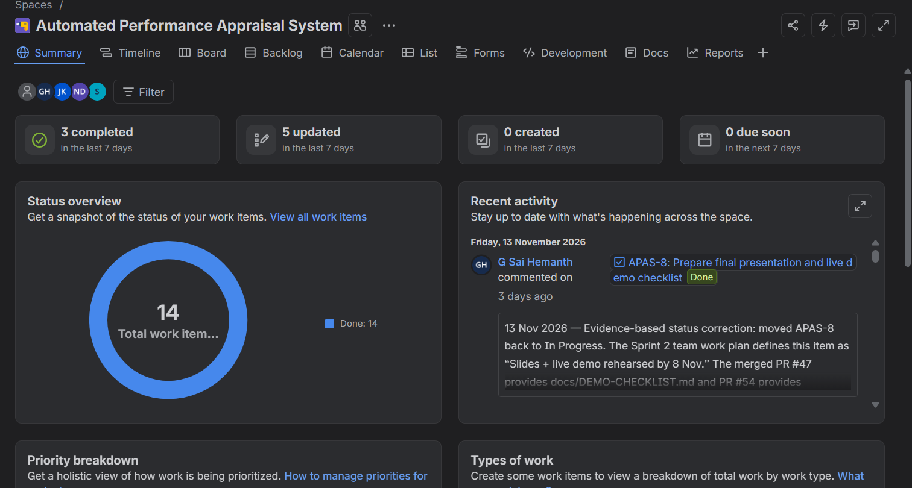
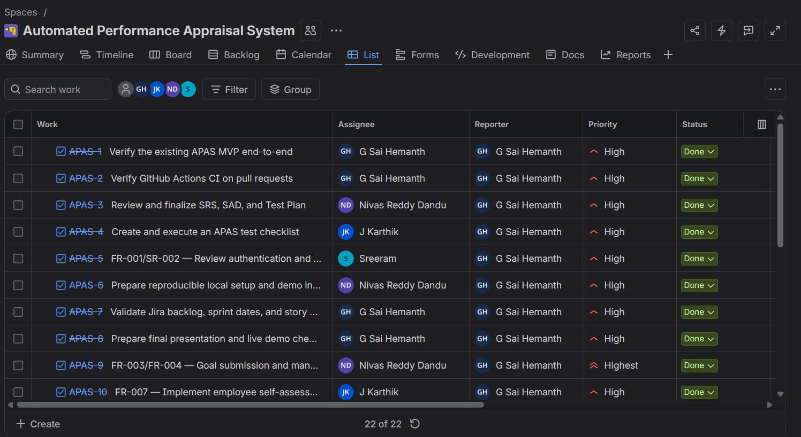
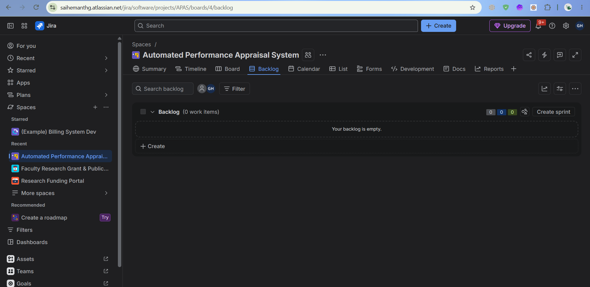
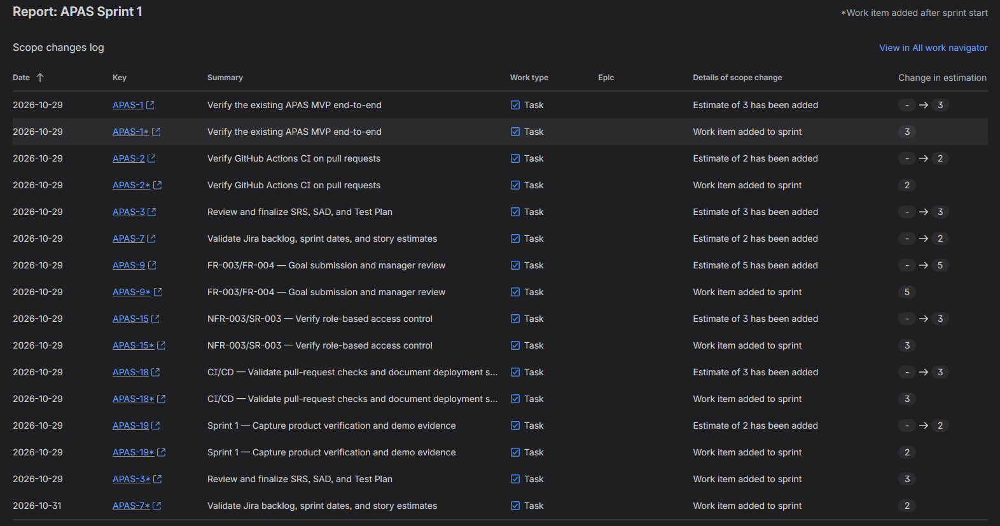
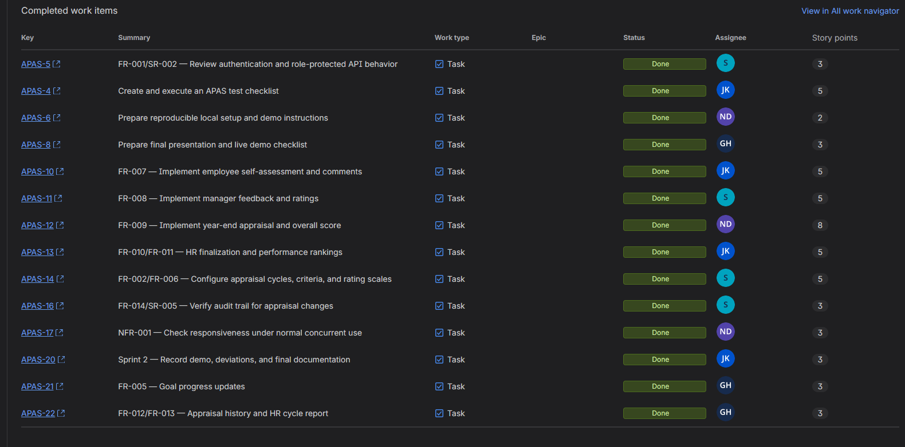
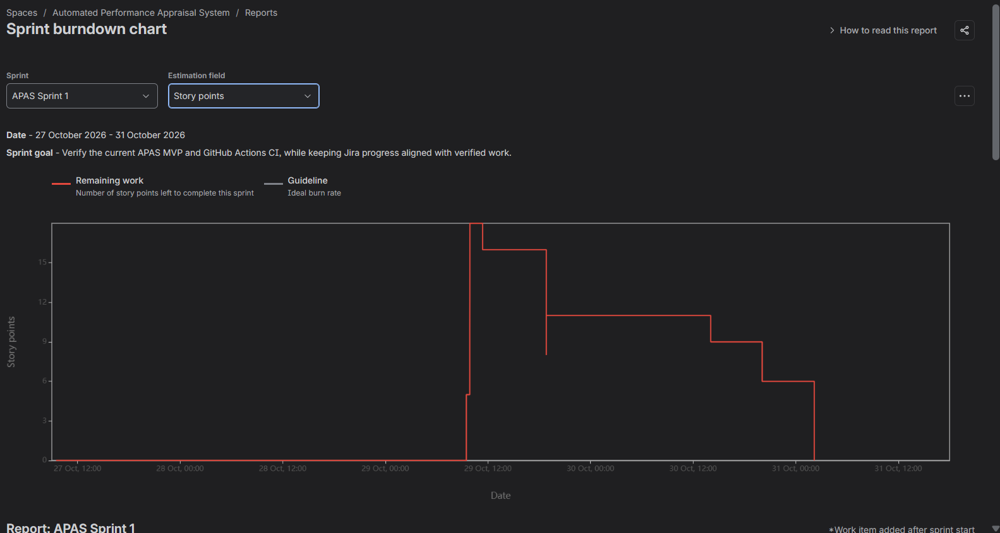
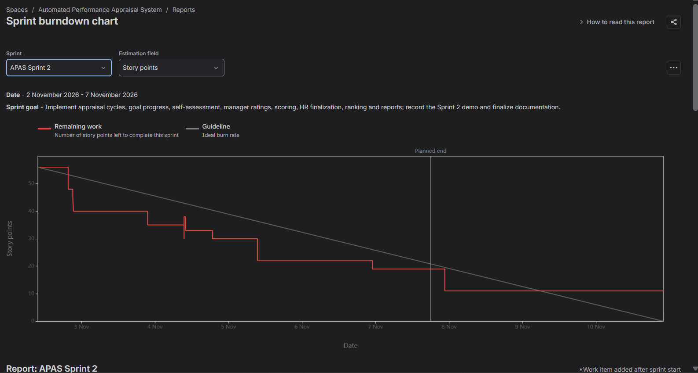

# Jira evidence

Screenshots from the Jira project **APAS** (board 4), taken on 16 Nov 2026 after both sprints were closed. The tables below list the same data as the screenshots, so they can be checked against Jira.

| | Sprint 1 | Sprint 2 |
|---|---|---|
| Dates | 27–31 Oct 2026 | 2–7 Nov 2026 (planned end) |
| Goal | Verify the current APAS MVP and GitHub Actions CI, keeping Jira aligned with verified work | Implement cycles, goal progress, self-assessment, manager ratings, scoring, HR finalization, ranking and reports; record the Sprint 2 demo and finalize documentation |
| Items | 8 | 14 |
| Story points committed | 23 | 56 |
| Story points completed | 23 | 56 |
| Closed | 31 Oct 2026 | 10 Nov 2026 |

## 1. Jira dashboard

## 2. Product backlog

All 22 work items (22 of 22) with their owner, priority and status.

The board backlog is empty because every work item was completed in Sprint 1 or Sprint 2:

## 3. Sprint backlogs

### Sprint 1 (27–31 Oct 2026): 8 items, 23 points

Sprint 1 report, scope log: the 8 items and their estimates were added on 29 Oct (APAS-7 on 31 Oct).

| Key | Work item | Owner | Points |
|---|---|---|---|
| APAS-1 | Verify the existing APAS MVP end-to-end | G Sai Hemanth | 3 |
| APAS-2 | Verify GitHub Actions CI on pull requests | G Sai Hemanth | 2 |
| APAS-3 | Review and finalize SRS, SAD, and Test Plan | Nivas Reddy D | 3 |
| APAS-7 | Validate Jira backlog, sprint dates, and story estimates | G Sai Hemanth | 2 |
| APAS-9 | FR-003/FR-004: goal submission and manager review | Nivas Reddy D | 5 |
| APAS-15 | NFR-003/SR-003: verify role-based access control | D A V Sreeram | 3 |
| APAS-18 | CI/CD: validate pull-request checks and document deployment | G Sai Hemanth | 3 |
| APAS-19 | Sprint 1: capture product verification and demo evidence | J Karthik | 2 |

### Sprint 2 (2–7 Nov 2026): 14 items, 56 points

Sprint 2 report, completed work items: all 14 items Done with their owners and story points.

| Key | Work item | Owner | Points |
|---|---|---|---|
| APAS-4 | Create and execute an APAS test checklist (test reports) | J Karthik | 5 |
| APAS-5 | FR-001/SR-002: authentication and role-protected API | D A V Sreeram | 3 |
| APAS-6 | Reproducible local setup and final documents | Nivas Reddy D | 2 |
| APAS-8 | Final presentation and live demo checklist | G Sai Hemanth | 3 |
| APAS-10 | FR-007: employee self-assessment and comments | J Karthik | 5 |
| APAS-11 | FR-008: manager feedback and ratings | D A V Sreeram | 5 |
| APAS-12 | FR-009: year-end appraisal and overall score | Nivas Reddy D | 8 |
| APAS-13 | FR-010/FR-011: HR finalization and rankings | J Karthik | 5 |
| APAS-14 | FR-002/FR-006: appraisal cycles, criteria and rating scales | D A V Sreeram | 5 |
| APAS-16 | FR-014/SR-005: audit trail for appraisal changes | D A V Sreeram | 3 |
| APAS-17 | NFR-001: responsiveness under concurrent use | Nivas Reddy D | 3 |
| APAS-20 | Sprint 2 demo video, deviations and final documentation | J Karthik | 3 |
| APAS-21 | FR-005: goal progress updates | G Sai Hemanth | 3 |
| APAS-22 | FR-012/FR-013: appraisal history and HR cycle report | G Sai Hemanth | 3 |

## 4. Sprint progress

Progress is shown by the sprint reports in section 3 (Sprint 2: 14 of 14 items completed, 56 of 56 points) and by the burndown charts in section 5, which track the remaining story points day by day. Velocity: 23 points in Sprint 1, 56 points in Sprint 2.

## 5. Burndown charts

Sprint 1: the work items and estimates were added to the sprint on 29 Oct, after the first two days were spent verifying the existing MVP; all 23 points were completed by the end of the sprint.

Sprint 2: scope stayed at 56 points with no items added mid-sprint, and completed work ran ahead of the guideline for most of the sprint. Remaining work stayed at or below the guideline for most of the sprint; by the planned end on 7 Nov, 45 of 56 points were done (11 remaining). The last 11 points (APAS-4 test reports, APAS-8 demo checklist, APAS-20 video and deviation log) were completed on 10 Nov, when the sprint was closed. The delay came from a corrupted patch file and the order in which the final pull requests had to merge; it is recorded here rather than hidden.
